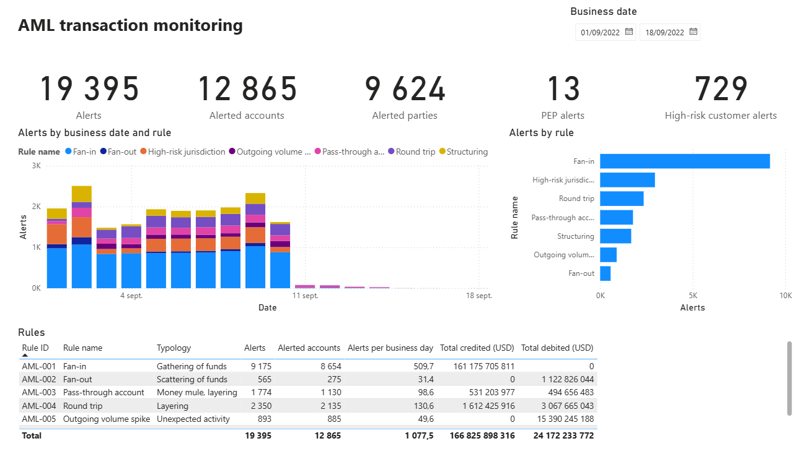
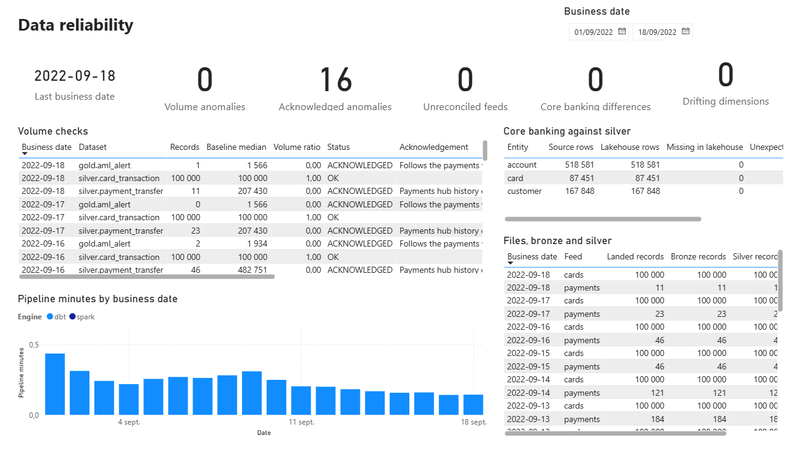
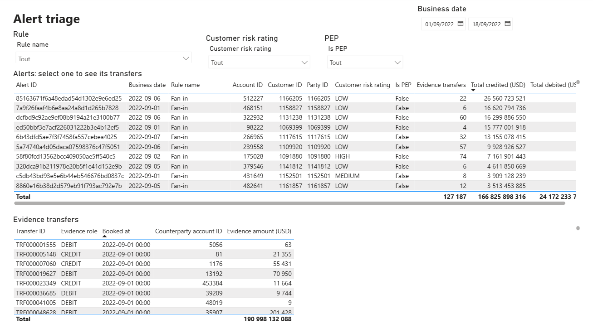
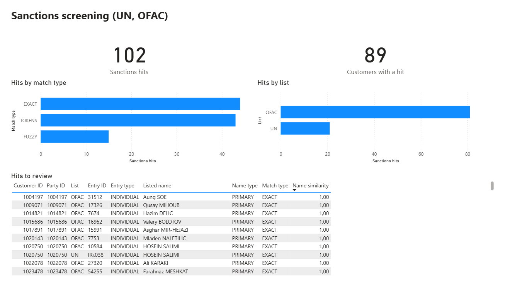

# AML Compliance Data Platform

On-premise data platform for anti-money-laundering (AML) monitoring at a retail
bank: transaction monitoring rules, sanctions screening and a customer 360 view,
published daily to compliance officers, built on open-source components that run
inside the bank's own data centre.

## The problem

A bank must report suspicious movements of money and must not serve anyone on a
sanctions list. Both depend on data that arrives every day from several systems:
wire transfers, card payments, the customer database and the UN and OFAC lists.

Most failures in that chain are silent. A truncated file, a field whose format
changes, a customer record that goes stale: the monitoring still runs, the
dashboard still refreshes, and the alerts are computed on the wrong data. A missed
alert is a regulatory finding; a wrong one costs an investigator hours.

This platform loads each business day, checks it at every step, runs the
detection rules and the screening, and publishes the day only once every check
has passed. When something is wrong, the day is held, the cause is named, and the
person on duty has a procedure to resume it.

## Results

Measured over 18 business dates: 5,078,345 transfers, 1,800,000 card
transactions, 167,848 customers.

| | |
|---|---|
| Daily run | One business date from delivered files to published report in about 4 minutes, on a 4-core, 16 GB workstation |
| Completeness | Every feed reconciles from the delivered file to the reporting layer; customers, accounts and cards match the core banking system column by column |
| Laundering detection | On dates not used to tune the rules, 54.3% of laundering transfers raise an alert, and an alerted transfer is 20.7 times more likely to be laundering than the average transfer. Alert precision is 9.7%: about one alert in ten holds a laundering transfer, the usual order for rule-based monitoring, where analysts triage every alert ([per rule](docs/pipeline.md#gold)) |
| Sanctions screening | Known-answer test: all 40 customers seeded with listed names are found, each on the right entry; 49 other customers share a listed name (precision 0.45) |
| Customer 360 | Known-answer test: all 1,641 seeded pairs of duplicate customer records are found, with no false match |
| Reproducibility | The 19 derived tables rebuild from raw data identical to the published ones |
| Injected file format change | Day held 1 minute 31 seconds after the file was read, with the file and the violated field named; published 3 minutes 14 seconds after the corrected redelivery ([postmortem](docs/postmortems/card-date-format.md)) |

## Compliance report

The Power BI report reads the published `main` branch through Trino; every card
matches the figure `make bi-figures` computes in SQL
([details](docs/pipeline.md#compliance-reporting)).





<details>
<summary>Alert triage and sanctions screening pages</summary>





</details>

## How it works


| Layer | Holds |
|---|---|
| bronze | Data exactly as delivered, typed against its contract, with every version of every customer record |
| silver | Cleaned and matched data: transfers resolved to accounts, customer histories, customers of the same person grouped |
| gold | What compliance works from: alerts with the transfers behind them, sanctions hits |
| observability | Reconciliations, volume and drift checks, run metrics |

The lakehouse works like a Git repository for tables. Each run writes and checks
on the staging branch `etl`; only a run whose audits all pass is merged into
`main`, in one atomic commit across every table. Compliance officers and the
report read `main`, so they never see a partial or failed day, and any past state
can be read back for an examiner
([ADR 0001](docs/adr/0001-lakehouse-on-iceberg-nessie-trino.md)).

## Reliability guarantees

| Guarantee | Mechanism | Decision |
|---|---|---|
| A day is published whole or not at all | Write-audit-publish on a Nessie branch; the merge into `main` is atomic across tables | [0001](docs/adr/0001-lakehouse-on-iceberg-nessie-trino.md) |
| A malformed file never reaches a report | Schemas derived from [ODCS](contracts) contracts; manifests and control trailers; a file is accepted or rejected whole and quarantined with the reason; the audit fails if a dated feed has no accepted file | [0004](docs/adr/0004-source-feeds-and-data-contracts.md), [0005](docs/adr/0005-bronze-batch-ingestion.md) |
| Running a day again changes nothing | Files registered by checksum; Kafka offsets stored in the same commit as the data; dbt replaces the business date it builds | [0005](docs/adr/0005-bronze-batch-ingestion.md), [0006](docs/adr/0006-core-banking-change-data-capture.md), [0008](docs/adr/0008-silver-layer-with-dbt.md) |
| No change to a customer is lost, deletes included | Log-based change data capture (Debezium) from the core banking write-ahead log; at-least-once delivery, deduplicated by key and log position in silver | [0006](docs/adr/0006-core-banking-change-data-capture.md) |
| The numbers add up | Record counts and amount totals reconciled file to bronze to silver; current customers, accounts and cards compared column by column with the source database | [0010](docs/adr/0010-data-reliability-and-observability.md) |
| An unusual day is noticed | Volume against the median of comparable days (blocking for payments and cards); population stability index on key distributions (warning); acknowledged anomalies are reviewed records with a reason | [0010](docs/adr/0010-data-reliability-and-observability.md) |
| Any published table can be rebuilt | `make regeneration-check` rebuilds silver and gold from bronze and compares every table with `main` | [0010](docs/adr/0010-data-reliability-and-observability.md) |
| Every alert can be explained | Rules are SQL with versioned parameters; each alert carries the transfers behind it and the rule's parameters are in a catalogue table | [0009](docs/adr/0009-gold-aml-rules-and-sanctions-screening.md) |
| Detection quality is measured, not assumed | Labels kept outside the platform; thresholds frozen on five tuning dates, scored on five later dates | [0004](docs/adr/0004-source-feeds-and-data-contracts.md), [0009](docs/adr/0009-gold-aml-rules-and-sanctions-screening.md) |
| Personal data stays where it belongs | Direct identifiers in a `restricted` zone; per-user Trino access rules; the report never reads names | [0008](docs/adr/0008-silver-layer-with-dbt.md), [0011](docs/adr/0011-compliance-reporting-in-power-bi.md) |
| A failed day can be resumed by the person on duty | Idempotent, retried tasks; resume from the failed task; [runbook](docs/runbook.md) with one procedure per failure; blameless [postmortems](docs/postmortems) | [0007](docs/adr/0007-orchestration-with-airflow.md) |

Eleven [decision records](docs/adr) give the context of each choice, the
alternatives rejected and the consequences, from the table format to the
reporting tool.

## Data sources

| Source | Delivery | Volume |
|---|---|---|
| Payments hub | Daily CSV file with manifest, from the IBM Transactions for Anti-Money Laundering dataset (HI-Small) | 5,078,345 transfers over 18 business dates, 515,088 accounts |
| Core banking | PostgreSQL tables `customer`, `account`, `card` | 167,848 customers, 518,581 accounts, 87,451 debit cards |
| Card processor | Daily pipe-delimited file with header and control trailer | 1,800,000 transactions over 18 business dates |
| Sanctions | UN Security Council consolidated list and OFAC SDN list (XML) | about 1,000 and 19,500 entries |

Each source has a contract in [contracts/](contracts) (Open Data Contract
Standard v3.1). Customer master data is derived from the IBM account holders
with a fixed seed; it carries seeded duplicate records and 40 customers named
after listed persons, as test cases for the customer 360 and the sanctions
screening. Labels used to measure detection quality, including those seeded
cases, are kept outside the platform ([ADR 0004](docs/adr/0004-source-feeds-and-data-contracts.md)).

## Stack

| Concern | Component |
|---|---|
| Object storage | SeaweedFS (S3 API) |
| Table format / catalog | Apache Iceberg / Project Nessie |
| Batch processing | Apache Spark 4.1 |
| SQL engine | Trino |
| Transformations | dbt-core 1.11 with dbt-trino |
| Change data capture | Debezium on Kafka Connect, Apache Kafka 4 (KRaft) |
| Orchestration | Apache Airflow 3 |
| Reporting | Power BI Desktop (PBIP project), open-source Trino connector over HTTPS |
| Source system | PostgreSQL 17 |
| Code quality | Python 3.12, uv, ruff, mypy, pytest, GitHub Actions |

## Getting started

Requirements: Docker with Compose v2, GNU Make, [uv](https://docs.astral.sh/uv/), 16 GB of RAM
(each container has a [memory limit](docs/pipeline.md#resource-profiles)).
On Windows, run everything from WSL2.

```bash
uv sync
make up                # core services, Spark and dbt images, bootstrap of namespaces and the etl branch
make data              # every source feed, about 3 minutes (IBM files: Kaggle credentials, or IBM_DIR=<folder>)
make cdc               # capture the core banking into Kafka
make pipeline          # bronze, silver, gold and the checks on etl, then one publish to main
make help              # all targets
```

To run day by day as in production:

```bash
make up-airflow                                      # Airflow on http://localhost:8081
make airflow-backfill FROM=2022-09-01 TO=2022-09-18  # one run per business date
```

## Pipeline stages

Commands, tables and figures for each stage are in [docs/pipeline.md](docs/pipeline.md).

| Stage | What it does | Measured |
|---|---|---|
| [Source data](docs/pipeline.md#source-data) | Builds the four feeds; injects delivery defects on demand | every feed in about 3 minutes |
| [Change data capture](docs/pipeline.md#change-data-capture) | Debezium reads the core banking write-ahead log into one compacted Kafka topic per table | 773,880-row snapshot in about 16 seconds |
| [Bronze ingestion](docs/pipeline.md#bronze-ingestion) | Spark loads files and change events, typed against the contracts; bad files quarantined with the reason | 18 dates in about 4 minutes |
| [Silver](docs/pipeline.md#silver) | dbt builds resolved transfers, customer histories, the customer 360 and screening keys; personal data split by zone | one date in about 45 seconds |
| [Gold](docs/pipeline.md#gold) | Seven AML rules with versioned thresholds, alert evidence, sanctions screening | one date in about 25 seconds |
| [Reliability](docs/pipeline.md#reliability) | Reconciliations, volume and drift checks, run metrics, regeneration check | adds 23 seconds to a daily run |
| [Orchestration](docs/pipeline.md#orchestration) | Airflow DAG `aml_daily`, one run per business date, resumable from any task | one date in about 4 minutes, ingestion to publish |
| [Compliance reporting](docs/pipeline.md#compliance-reporting) | Power BI project in plain text, imports `gold` and `observability` from `main` over HTTPS | figures checked against SQL |

## Testing and CI

| Level | What it covers | Command |
|---|---|---|
| Static | ruff lint and format, mypy | `make lint`, `make typecheck` |
| Unit (212 tests, no containers) | Feed formats and defects, contract parsing, ingestion checks, change event handling, DAG structure, evaluation metrics, regeneration comparison, Power BI project files | `make test-unit` |
| dbt unit tests | Change-log histories, customer matching and party grouping, AML rules, screening | `make test-dbt` |
| dbt data tests | Keys, relationships, histories and reconciliations; they gate each layer before the publish | run inside `make silver`, `gold`, `observability` |
| Integration (52 tests, running stack) | Write-audit-publish isolation, bronze ingestion, change data capture, Airflow runs, core banking access rights, reporting access over HTTPS | `make test-integration`, `make test-reporting` |
| Evaluation | Detection and matching quality against labels held outside the platform | `make evaluate-rules`, `evaluate-sanctions`, `evaluate-parties` |

[CI](.github/workflows/ci.yml) runs two jobs on every pull request. The first
runs the static checks, the unit tests, the Power BI project checks, and parses
the Compose file and the dbt project. The second starts the whole stack
(storage, catalog, Trino, Kafka, Airflow), runs the integration tests, builds
every silver, gold and observability model on empty tables, runs the dbt unit
tests, publishes, and reads every column the Power BI model imports as the `bi`
user over HTTPS.

## Operations

The [runbook](docs/runbook.md) starts from what the person on duty sees (a
failed task, a failed check) and ends with the date published, with one
procedure per failure. Incidents get a blameless [postmortem](docs/postmortems).
A game day injected a card file format change: the first run held the date only
at the volume check, three builds late; the bronze audit now fails on the
rejected file itself, 91 seconds after it is read
([postmortem](docs/postmortems/card-date-format.md),
[replay](docs/pipeline.md#game-day-card-file-format-change)).

## Limitations

- Single node: every service runs once, on one workstation. The design
  (Iceberg on S3 storage, Trino, Spark, Kafka, Airflow) scales out without
  changing the models, but no figure here was measured on a cluster.
- The payments feed covers 18 business dates; volume and drift baselines use
  the previous five comparable dates, so the first dates of the history have
  none.
- The laundering label covers the payments typologies only: structuring and
  customer-country rules are not measured by it.
- Sanctions screening and customer 360 are scored on seeded cases with a known
  answer. The scores show the matching logic works on the cases it was built
  for; they are not a measure of performance on real customer data.
- Failed runs show in Airflow; nothing pages the person on duty.

## Repository layout

```
contracts/           data contracts (ODCS v3.1) and the ODCS JSON Schema
bi/                  Power BI project: semantic model (TMDL) and report (PBIR)
dags/                Airflow DAGs
docs/adr/            architecture decision records
docs/pipeline.md     commands, tables and figures per stage
docs/runbook.md      operating procedures
docs/postmortems/    incident reviews and their template
infra/               container configuration (Postgres init, Spark and dbt images, Trino catalogs, memory and access rules)
jobs/                Spark jobs, mounted into the Spark container
src/aml_platform/    Python package: lakehouse operations, source feeds, contracts, change data capture, ingestion, orchestration rules, evaluation, regeneration check, Power BI project checks
transform/           dbt project: silver, gold and observability models, tests, macros, layer selectors
tests/unit/          fast tests, no containers
tests/integration/   tests against the running stack
```

## License

[MIT](LICENSE)
