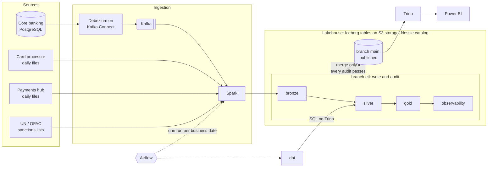

# Pipeline reference

Commands, tables and measured figures for each stage. The [README](../README.md) gives the overview; decisions and rejected alternatives are in [adr/](adr).

## Architecture as text



## Source data

```bash
make data              # every feed below, in order (about 3 minutes)
make data-ibm          # IBM files from the Kaggle API (KAGGLE_API_TOKEN or ~/.kaggle/kaggle.json)
make data-ibm IBM_DIR=~/Downloads/ibm-aml   # or verify files downloaded from the Kaggle website
make data-payments     # daily payments files + ground truth
make data-sanctions    # UN and OFAC lists
make data-corebanking  # customers, accounts and cards into PostgreSQL (REPLACE=1 to reload)
make data-cards        # card processor files
uv run aml-sources cards --defect 2022-09-05:truncated   # inject a delivery defect: truncated, duplicates, date-format
make data-kyc-changes SEED=2   # one day of back-office changes in the core banking
```

Everything is written under `data/` (git-ignored): `raw/` for vendor files,
`landing/` for the feeds the platform ingests, `ground_truth/` for labels.

## Change data capture

```bash
make cdc               # Kafka + Kafka Connect, capture role and publication, topics, Debezium connector
make cdc-status        # connector state, events per topic, replication slot lag
make cdc-reset         # remove the capture; the next `make cdc` takes a new snapshot
```

Debezium reads the core banking write-ahead log through a publication on
`customer`, `account` and `card`, and publishes one compacted topic per table
(`corebanking.core.<table>`). The initial snapshot of the 773,880 rows takes
about 16 seconds ([ADR 0006](adr/0006-core-banking-change-data-capture.md)).

## Bronze ingestion

```bash
make bronze                 # reset etl, ingest landed files and change events, audit, publish to main
make ingest SOURCE=cards    # one source only, on the etl branch (payments | cards | sanctions | files | corebanking)
make audit-bronze           # table-level checks on etl; non-zero exit blocks the publish
make bronze-tables          # create the bronze and audit tables, empty, on a fresh environment
make publish                # merge etl into main
```

Spark reads the landing zone read-only and writes Iceberg tables whose schemas
are derived from the contracts. A file is accepted or rejected as a whole;
rejected files are copied to `data/quarantine/<feed>/` with the reason
([ADR 0005](adr/0005-bronze-batch-ingestion.md)). Re-running ingests
nothing twice.

| Table | Content |
|---|---|
| `bronze.payment_transfer` | Payments hub records, partitioned by business date |
| `bronze.card_transaction` | Card processor detail records, resent records removed |
| `bronze.sanctions_un_individual`, `bronze.sanctions_un_entity`, `bronze.sanctions_ofac_sdn_entry` | Every landed list snapshot |
| `bronze.corebanking_customer`, `bronze.corebanking_account`, `bronze.corebanking_card` | Every captured version of the core banking rows: snapshot, creates, updates and deletes with their source position |
| `audit.ingestion_run`, `audit.ingestion_file` | One row per run and feed, one per file and table (also the ingestion registry) |
| `audit.change_batch` | Topic partition ranges read by each change data capture run |
| `audit.publish_check` | Results of the checks run before each publish |

A full load of the 18 business dates (5,078,345 payment records, 1,800,000 card
records, both sanctions lists) takes about four minutes on a 4-core workstation;
the core banking snapshot (773,880 change events) about one minute, and a day of
changes about 30 seconds.

Change events are read from the offset after the last one stored in the bronze
table, so the consumed position is committed together with the data. An event
that breaks the contract, such as a column added at the source, stops the run
before anything is written.

## Silver

```bash
make silver                   # build and test silver on etl, every business date
make silver DATE=2022-09-05   # one business date
make test-dbt                 # dbt unit tests (history, matching, party grouping, AML rules, screening)
make evaluate-parties         # precision and recall of the customer 360 against the ground truth
```

The dbt project in [transform/](../transform) builds silver from bronze on the
`etl` branch only; its tests run before the publish
([ADR 0008](adr/0008-silver-layer-with-dbt.md)).

| Table | Content |
|---|---|
| `silver.payment_transfer` | Transfers with normalized bank ids and both accounts resolved to the core banking, by business date |
| `silver.card_transaction` | Card transactions in major units, signed, resolved to card and account, by business date |
| `silver.customer_history`, `silver.account_history`, `silver.card_history` | Type 2 histories at daily grain, derived from the change logs |
| `silver.customer_match`, `silver.party_member`, `silver.party` | Customer records of the same party, with the rules that link them; customer 360 per party |
| `silver.sanctions_entry`, `silver.sanctions_name` | Latest UN and OFAC entries; every primary name and alias with its screening key |
| `restricted.customer_identity` | Names, identity documents and contact details of current customers |
| `silver.fx_rate` | Rate from each currency to USD, as the payments hub applies it |
| `reference.iso_currency` | Currency codes of the card processor |
| `reference.high_risk_jurisdiction` | FATF lists, with the dates they were in force |

Personal data is split by zone. Silver holds internal keys and analytical
attributes (birth year, city, risk rating); direct identifiers are in
`restricted`. Trino access rules ([infra/trino/rules.json](../infra/trino/rules.json)):

| Trino user | Reads |
|---|---|
| `analyst` | `silver` and `reference` on `main` |
| `bi` | same, plus `gold` |
| `compliance` | same, plus `restricted` |
| `dbt`, `trino`, `integration-test` | everything, both branches |

On the 167,848 customer records, the party resolution finds 1,641 pairs of
records of the same party with pairwise precision 1.00 and recall 1.00 against
the ground truth: 157,713 parties. A full silver build takes about 2 minutes 40
seconds, one business date about 45 seconds.

## Gold

```bash
make gold                         # AML rules and sanctions screening on etl, one business date at a time
make gold DATE=2022-09-05         # one business date
make evaluate-rules               # precision and recall of each rule against the laundering label
make evaluate-rules FROM=2022-09-06 UNTIL=2022-09-10   # validation dates only
make evaluate-sanctions           # precision and recall of the screening against the planted customers
```

| Table | Content |
|---|---|
| `gold.aml_rule` | Rule catalogue: id, typology, description and the parameters it runs with |
| `gold.aml_alert` | One alert per rule, account and business date, with the holder's risk rating and PEP flag on that date |
| `gold.aml_alert_transfer` | The transfers behind each alert |
| `gold.sanctions_hit` | Current customers whose name matches a UN or OFAC listed name, with the match type |

Seven rules run on every business date: fan-in, fan-out, pass-through, round
trip, volume spike, structuring, high-risk jurisdiction. Their parameters are
versioned in [transform/dbt_project.yml](../transform/dbt_project.yml), which also
renders the catalogue ([ADR 0009](adr/0009-gold-aml-rules-and-sanctions-screening.md)).
Thresholds were chosen on business dates 2022-09-01 to 2022-09-05 and then
frozen; the scores below are on 2022-09-06 to 2022-09-10, which played no part in
choosing them (2,310,405 transfers, 2,523 labelled):

| Rule | Alerts | Alert precision | Recall | Lift over base rate |
|---|---|---|---|---|
| AML-001 fan-in | 4,551 | 8.0% | 24.4% | 13.2 |
| AML-002 fan-out | 217 | 15.2% | 6.2% | 123.2 |
| AML-003 pass-through | 876 | 38.5% | 21.2% | 250.3 |
| AML-004 round trip | 1,342 | 7.2% | 6.1% | 48.8 |
| AML-005 volume spike | 533 | 16.1% | 5.2% | 82.5 |
| AML-006 structuring | 780 | 0.9% | 0.3% | 1.9 |
| AML-007 high-risk jurisdiction | 1,433 | 1.0% | 1.2% | 3.2 |
| All rules | 9,732 | 9.7% | 54.3% | 20.7 |

On the tuning dates the same rules score 6.4% alert precision and 44.3% recall:
the first dates have little account history behind them.

Alert precision is the share of alerts holding at least one labelled transfer;
recall and lift are computed on transfers. The label does not cover structuring or
customer countries, so AML-006 and AML-007 cannot be judged by it. Sanctions
screening hits all 40 customers planted on the lists, on the right entry, and 49
other customers who share a listed name (precision 0.45). Gold for one business
date builds in about 25 seconds; the 18 dates in about 5 minutes 30 seconds.

## Reliability

```bash
make observability                # reconcile and check every date on etl (DATE=YYYY-MM-DD for one)
make regeneration-check           # rebuild silver and gold from bronze on etl, compare every table with main
```

Each daily run ends with checks that the earlier audits cannot make, since every
file and model can pass its own rules while the day is still wrong
([ADR 0010](adr/0010-data-reliability-and-observability.md)):

| Table (`observability`) | What it checks | On failure |
|---|---|---|
| `layer_reconciliation` | Records landed, in bronze and in silver, and amount control totals, per date and feed | Publish held |
| `corebanking_reconciliation` | Silver's current customers, accounts and cards against the core banking database, column by column, as of the last captured change | Publish held |
| `volume_check` | Each dataset's daily count against the median of the previous dates of the same kind (weekday or weekend) | Payments and cards: publish held; alerts: warning |
| `distribution_drift` | Population stability index of payment formats, currencies, amount bands, card channels and alerts by rule | Warning |
| `pipeline_run` | Duration, records written, attempts and failed nodes of each step of each published run | — |

Investigated anomalies are acknowledged in the seed
[acknowledged_anomaly.csv](../transform/seeds/acknowledged_anomaly.csv), with the
reason, and left out of later baselines. Two are acknowledged: the first date of
the payments history, which carries 481,056 opening REINVESTMENT transfers, and
the dates after 2022-09-10, which carry 11 to 396 transfers a day.

Over the 18 dates: every feed reconciles from file to silver (5,078,345 transfers,
1,800,000 card transactions); 167,848 customers, 518,581 accounts and 87,451
cards match the core banking. The checks add 23 seconds to a daily run. The
regeneration check takes about 7 minutes; on its first run it found the
currency rates computed with an approximate median, which differed between two
builds of the same data by a cent on 426 alert amounts. With exact percentiles,
the 19 derived tables rebuild identical to `main`.

## Orchestration

```bash
make up-airflow                                   # Airflow on http://localhost:8081, builds the Spark and dbt images
make airflow-backfill FROM=2022-09-01 TO=2022-09-18   # load each business date, one run per date
make airflow-run DATE=2022-09-05                  # one business date
make airflow-clear DATE=2022-09-08 TASK=ingest_cards   # resume a failed run from one task
make airflow-status                               # latest runs
```

The DAG `aml_daily` loads one business date per run and publishes it with the
same write-audit-publish cycle as `make pipeline`:

```
wait_for_deliveries -> open_staging -> ingest_payments, ingest_cards, ingest_sanctions, ingest_corebanking
                    -> audit_bronze -> build_silver -> audit_silver -> build_gold -> audit_gold
                    -> build_observability -> audit_observability -> publish
```

| Behaviour | How |
|---|---|
| Never publish a date with a feed missing | The run waits (sensor, up to 12 h) for the payments manifest and the card file of its date; the audit fails unless every feed of the run is on the staging branch and the date holds an accepted payments and card file |
| One run at a time on `etl` | `open_staging` waits while another active run, backfill included, holds the branch |
| Transient failures | Ingestion tasks retry with exponential backoff; they are idempotent |
| Data failures | The audits (bronze checks, silver, gold and observability dbt tests) do not retry; the run stops before `publish` |
| Resume | Clear the failed task with its downstream tasks (`make airflow-clear DATE= TASK=`): completed feeds stay on `etl`. Clear the whole run to start again from `main` |
| Traceability | Ingestion run ids are `<airflow run id>#<attempt>` in `audit.ingestion_run`; dbt nodes of each run in `audit.dbt_node_run` |

Spark jobs run as containers of the Docker host, started through a socket proxy
that exposes containers and images only, one at a time through a single-slot
pool ([ADR 0007](adr/0007-orchestration-with-airflow.md)). Unpausing the
DAG, which both targets do, also starts its daily schedule.

## Compliance reporting

```bash
make bi-check      # report, semantic model and dbt contracts agree; files match Microsoft's schemas
make bi-figures    # the figures each card must show, read as bi over HTTPS (FROM=, UNTIL=YYYY-MM-DD)
```

[bi/](../bi) is a Power BI project: the semantic model in TMDL, the report in PBIR,
both plain text, reviewed like code ([ADR 0011](adr/0011-compliance-reporting-in-power-bi.md)).
The model imports `gold` and `observability` from `main` as the `bi` user, which
never reads names or unpublished data.

| Page | For | Shows |
|---|---|---|
| Alerts | Compliance officers | Alerts, alerted accounts and parties, PEP and high-risk alerts; alerts by date and rule; per-rule totals |
| Alert triage | Compliance officers | Alerts filtered by rule, risk rating and PEP; the transfers behind the selected alert |
| Sanctions screening | Compliance officers | Hits by match type and list; customer, listed entry and name similarity of each hit |
| Data reliability | Data team | Last published date, volume anomalies, unreconciled feeds, core banking differences, drift; volume checks per date; pipeline minutes |

Over the 18 dates, `make bi-figures` gives 19,395 alerts on 12,865 accounts
(9,624 parties), 13 on PEP accounts and 729 on high-risk customers, 127,187
evidence transfers, 98 sanctions hits on 89 customers, and no unacknowledged
volume anomaly, unreconciled feed, core banking difference or drift. The UN and
OFAC lists are downloaded when `make data` runs, so the hit count follows their
current entries.

To open it, on Windows, with the stack running in WSL2:

1. Install Power BI Desktop and the
   [Trino connector](https://github.com/CreativeDataEU/PowerBITrinoConnector): copy
   [`Trino.mez`](https://github.com/CreativeDataEU/PowerBITrinoConnector/raw/910dda9edf9fa9b68de9e5210c799cada97657e7/Trino/bin/AnyCPU/Debug/Trino.mez)
   (SHA-256 `30a4bb8ab4c72db8b81243f39579c64b15d72b95dc9204220fae1f78f9c37c0b`) to
   `Documents\Power BI Desktop\Custom Connectors`. In **Options**, **Security**,
   **Data Extensions**, allow any extension to load, then restart Desktop.
2. Trust the certificate of `localhost:8443`: copy it with
   `docker compose cp trino:/etc/trino/security/trino.crt data/trino.crt`, then, in an
   administrator PowerShell,
   `Import-Certificate -FilePath trino.crt -CertStoreLocation Cert:\LocalMachine\Root`.
3. Open `bi/AmlCompliance.pbip`. When asked for credentials of `localhost:8443`, choose
   **Basic** (user name and password), user `bi`, the password `TRINO_BI_PASSWORD` of `.env`.
4. Refresh. The cards match `make bi-figures` for the same dates.

People log in to Trino over HTTPS on port 8443 with a password (`bi`,
`compliance`, `analyst`); the key pair and password file are generated at the
first `make up`. Services of the stack keep the HTTP listener on port 8080.

| Service | URL |
|---|---|
| Airflow | http://localhost:8081 |
| Trino (services) | http://localhost:8080 |
| Trino (people and reporting tools, password) | https://localhost:8443 |
| Nessie API | http://localhost:19120 |
| S3 endpoint | http://localhost:8333 |
| Kafka (host listener) | localhost:29092 |
| Kafka Connect REST | http://localhost:8083 |
| Core banking PostgreSQL | localhost:5432 |

All ports bind to `127.0.0.1`. Credentials in `.env.example` are for local use only.

## Game day: card file format change

A file format change at the card processor was injected on business date
2022-09-08 to test the procedures:

```bash
uv run aml-sources cards --start 2022-09-08 --end 2022-09-08 --defect 2022-09-08:date-format
make airflow-run DATE=2022-09-08          # rejected; audit_bronze fails with the reason
uv run aml-sources cards --start 2022-09-08 --end 2022-09-08   # the processor's corrected redelivery
make airflow-clear DATE=2022-09-08 TASK=ingest_cards           # resumed and published
```

The contract check rejected the file, but the bronze audit passed and the date
was only held at the volume check, three builds later. The audit now fails on
the rejected file itself; the [postmortem](postmortems/card-date-format.md)
has the timeline and the open actions. With 2022-09-08 held and then published,
and the following dates loaded by backfill, the report figures over the 18
dates are the same as without the incident.

## Resource profiles

Each container has a memory limit so the stack fits on a 16 GB workstation.

| Profile | Services | Memory limit |
|---|---|---|
| default | PostgreSQL ×2, SeaweedFS, Nessie, Trino | ~5.7 GB |
| `dbt` | dbt (on demand) | +1 GB |
| `cdc` | Kafka, Kafka Connect | +2 GB |
| `spark` | Spark driver (on demand) | +2 GB |
| `airflow` | Airflow API server, scheduler (runs the tasks), DAG processor, Docker socket proxy | +3.3 GB |
